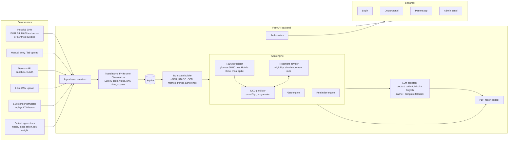

# CLAUDE.md: GlycoRenal Twin (project spec for Claude Code)

Claude Code reads this file automatically on every prompt. It is the single source of truth for the build.
If a prompt conflicts with this file, follow the prompt and update this file.

---

## 0. Who you are working with

- The owner, **Shiwangi**, is a B.Pharm student and **not a programmer**. She owns the clinical logic.
- After every task:
  1. Explain in 3–6 plain-English lines what you built.
  2. Give the **exact commands** to run it and what she should see.
  3. Commit with a clear message (`git add -A && git commit -m "..."`).
- Never ask her to edit Python. Clinical numbers she may change live in `config/*.yaml` and `data/reference/*.csv`, so keep them there.
- If something needs a key, an account or a download only she can do, stop and tell her step by step.
- Prefer simple, readable code over clever code. Add a docstring on every module.
- **Deadline: 20 Oct 2026; target a working prototype by Fri 16 Oct night.** Always keep `main` runnable. Follow `FAST_TRACK.md` (7 merged prompts); `BUILD_PROMPTS.md` has the detailed version. When time-boxed, ship the simplest working version and log cuts in README limitations.

---

## 1. What we are building

A proof-of-concept **digital twin** for people with **Type 2 Diabetes (T2DM)** that:

1. **Track A (T2DM):** predicts short-term glycaemic events and HbA1c in 3 months.
2. **Track B (DKD):** predicts diabetic kidney disease onset (2–3 yrs) and progression.
3. Links them: glycaemic features feed the DKD model.
4. Simulates treatments on the twin and ranks them by predicted risk reduction (doctor decides).
5. Ingests **hospital EHR data (FHIR R4)** and **real-time wearable data** (CGM, heart rate, steps, sleep, BP).
6. Has **role-based logins** (doctor, patient, admin), **medication reminders**, an **Indian meal log**, an **LLM assistant** (explains, never predicts) and **PDF reports**.

Built for the Digital Twin Challenge 2026 (Happiest Health Summit, Bengaluru). It does no auto-prescribing.

---

## 2. Tech stack (do not change without asking)

| Layer | Choice |
|---|---|
| Language | Python 3.11 |
| Backend API | FastAPI + Uvicorn |
| Database | SQLite via SQLModel (file: `data/twin.db`). Code must stay PostgreSQL-compatible |
| Auth | Username + password, bcrypt hashing (`passlib`), JWT tokens (`python-jose`), roles: `admin`, `doctor`, `patient` |
| Frontend | Streamlit multipage app that calls the FastAPI backend over HTTP (`httpx`) |
| Live refresh | `st.fragment(run_every=...)` for auto-refreshing charts |
| Charts | Plotly |
| ML | pandas, numpy, scikit-learn, XGBoost, joblib (saved models in `models/`) |
| FHIR | `fhir.resources` (R4) for parsing, `httpx` for FHIR servers |
| Background jobs | APScheduler inside FastAPI (simulator, reminders, daily DKD re-run) |
| LLM | Any OpenAI-compatible endpoint via the `openai` Python SDK. Primary: **Kimi (Moonshot AI)**; optional backup: Gemini |
| PDF | `fpdf2` with text shaping on (`uharfbuzz`) + Noto Sans and Noto Sans Devanagari fonts for Hindi |
| Tests | pytest |
| Packaging | Docker + docker-compose; GitHub Actions runs pytest |

---

## 3. Architecture



**Living-twin loop:** every new Observation leads to (1) save, (2) instant alert checks, (3) rolling CGM metrics update, (4) T2DM short-term re-run. DKD re-runs only on a new lab, a medication change, or once daily, so it is never run on every CGM point.

---

## 4. Repo structure

```
glycorenal-twin/
├── CLAUDE.md                  # this file
├── BUILD_PROMPTS.md           # step-by-step build plan
├── README.md
├── .env.example               # template only; real .env is git-ignored
├── requirements.txt
├── Dockerfile
├── docker-compose.yml
├── config/
│   ├── clinical_rules.yaml    # targets, KDIGO cut-offs, drug eligibility, effect sizes (Shiwangi owns)
│   ├── alerts.yaml            # alert thresholds
│   └── settings.py            # reads .env (pydantic-settings)
├── data/
│   ├── raw/                   # downloads (git-ignored)
│   ├── processed/             # cleaned/merged (git-ignored)
│   ├── synthetic/             # generated cohort (git-ignored, re-creatable)
│   ├── fhir_samples/          # small Synthea bundles for demo (committed, <5 MB)
│   ├── reference/
│   │   ├── indian_foods.csv   # food, serving, carbs_g, GI category (Shiwangi verifies vs IFCT 2017)
│   │   └── loinc_map.csv      # our variable name <-> LOINC code <-> unit
│   └── guidelines/            # short markdown notes from KDIGO 2022 + ADA, used for RAG
├── models/                    # trained .joblib files + model_card.md
├── scripts/
│   ├── download_data.py
│   ├── build_synthetic_cohort.py
│   ├── train_models.py
│   └── seed_demo.py           # creates demo users, patients, 14 days of data
├── src/
│   ├── db/                    # SQLModel tables, session
│   ├── auth/
│   ├── clinical/              # egfr.py, kdigo.py, cgm_metrics.py, units.py
│   ├── ingestion/
│   │   ├── translator.py      # anything -> Observation
│   │   ├── fhir_import.py
│   │   ├── dexcom.py
│   │   ├── libre_csv.py
│   │   ├── simulator.py
│   │   └── manual.py
│   ├── twin/state.py          # builds TwinState from DB
│   ├── models/                # t2dm.py, dkd.py (load + predict)
│   ├── treatment/             # eligibility.py, simulate.py, rank.py
│   ├── alerts/
│   ├── reminders/
│   ├── meals/
│   ├── llm/                   # client.py, prompts.py, guardrails.py, rag.py, fallback.py
│   └── reports/               # pdf_doctor.py, pdf_patient.py
├── api/
│   ├── main.py
│   └── routers/               # auth, patients, observations, ehr, devices, twin, treatments, alerts, reminders, meals, llm, reports, admin
├── app/                       # Streamlit
│   ├── Home.py                # login + role routing
│   ├── api_client.py
│   └── pages/
├── tests/
├── docs/                      # architecture.md, demo_script.md, model_card copy
└── .github/workflows/ci.yml
```

---

## 5. Data model (SQLModel tables)

- `User`: id, username, password_hash, role (`admin|doctor|patient`), full_name, language (`en|hi`), patient_id (nullable, for patients).
- `Patient`: id (e.g. `IND-0042`), display_name, sex, birth_year, dm_diagnosis_year, smoker, family_history_ckd, hypertension, assigned_doctor_id, fhir_id (nullable), created_at.
- `Observation`: id, patient_id, loinc_code, name, value, unit, effective_time, source (`ehr|dexcom|libre|simulator|manual|patient_app`), device (nullable), created_at. **All labs, vitals and wearable readings live here.**
- `Medication`: id, patient_id, drug, drug_class, dose, frequency, times (JSON list like `["08:00","20:00"]`), with_food, start_date, end_date, prescribed_by, source (`ehr|doctor`).
- `DoseEvent`: id, medication_id, scheduled_time, status (`pending|taken|missed|skipped`), responded_at.
- `Meal`: id, patient_id, time, items (JSON: food, servings), total_carbs_g, glucose_before, glucose_peak, spike (computed later).
- `Alert`: id, patient_id, type, severity (`info|warning|critical`), message, created_at, acknowledged_by, acknowledged_at.
- `Prediction`: id, patient_id, kind, value, details (JSON), model_version, created_at.
- `DeviceConnection`: id, patient_id, provider (`dexcom|libre|simulator`), status, tokens (store encrypted or never commit), last_sync.
- `LLMCache`: key (hash of mode+language+state), response, created_at.

Store de-identified IDs only in anything sent to the LLM. Never send names or phone numbers.

### LOINC codes (put in `data/reference/loinc_map.csv`)

| Variable | LOINC | Unit |
|---|---|---|
| HbA1c | 4548-4 | % |
| Glucose (lab / CGM / fingerstick) | 2339-0 | mg/dL (store `device` to tell CGM apart) |
| Serum creatinine | 2160-0 | mg/dL |
| eGFR (CKD-EPI 2021) | 98979-8 | mL/min/1.73m2 |
| UACR | 9318-7 | mg/g |
| Potassium | 2823-3 | mmol/L |
| Systolic BP | 8480-6 | mmHg |
| Diastolic BP | 8462-4 | mmHg |
| Heart rate | 8867-4 | /min |
| Body weight | 29463-7 | kg |
| BMI | 39156-5 | kg/m2 |
| Steps (daily) | 55423-8 | steps |
| Sleep duration | 93832-4 | h |
| LDL cholesterol | 13457-7 | mg/dL |

If a code is uncertain, keep it in the CSV with a `verify` flag rather than hard-coding it.

---

## 6. Clinical logic (values live in `config/clinical_rules.yaml`)

**Derived features**
- eGFR: **CKD-EPI 2021 race-free creatinine equation**. Unit-test against published examples.
- KDIGO: G1 ≥90, G2 60–89, G3a 45–59, G3b 30–44, G4 15–29, G5 <15. A1 <30, A2 30–300, A3 >300 mg/g. Use the standard heat-map colour (green/yellow/orange/red).
- CGM (last 14 days): TIR 70–180, TBR <70 and <54, TAR >180 and >250, mean glucose, GMI = 3.31 + 0.02392 × mean mg/dL, CV%, data sufficiency %.
- Trends: eGFR slope/yr, HbA1c change, BP-at-target, medication adherence % (7 and 30 days).
- Freshness flags: HbA1c > 6 months, UACR/creatinine > 12 months, no CGM > 2 h.

**Targets (editable):** HbA1c < 7%, TIR > 70%, TBR < 4%, BP < 130/80 if albuminuria else < 140/90.

**Drug eligibility (starter rules; Shiwangi verifies against KDIGO 2022 + ADA 2026 + product labels):**
- Metformin: avoid if eGFR < 30; do not start / reduce dose at 30–44.
- SGLT2 inhibitor: initiate if eGFR ≥ 20; continue until dialysis/transplant.
- GLP-1 RA: no eGFR restriction for most; caution with GI intolerance.
- ACEi/ARB: if albuminuria (A2/A3) or hypertension; monitor potassium and creatinine; never combine ACEi + ARB.
- Finerenone: T2DM + UACR ≥ 30 + eGFR ≥ 25 + K ≤ 5.0 + already on max-tolerated ACEi/ARB.
- Sulfonylurea / insulin: flag hypoglycaemia risk, especially when eGFR is low.

**Effect sizes for simulation (relative risk on kidney outcome; starter values, mark "to verify"):**
DAPA-CKD dapagliflozin HR ≈ 0.61; CREDENCE canagliflozin HR ≈ 0.70; FLOW semaglutide HR ≈ 0.76; FIDELIO-DKD finerenone HR ≈ 0.82. Also HbA1c-lowering estimates per class, plus BP control, 5% weight loss and +2,000 steps/day as lifestyle levers. Each entry stores its source citation.

**Treatment advisor flow:** eligible options → apply effect to the twin (HbA1c change → re-run DKD model; drug kidney HR multiplies DKD risk) → rank by absolute risk reduction → show "Add SGLT2i: DKD 3-yr risk 34% → 22% (source: DAPA-CKD)". Doctor view only. Patients see lifestyle levers only.

---

## 7. Models (`scripts/train_models.py` → `models/`)

Be honest about data limits in `models/model_card.md`.

| Model | Target | Training data | Method |
|---|---|---|---|
| `glucose_forecast` | CGM glucose at +30 and +60 min | CGMacros (T2D participants + others) | XGBoost regressor on lag features (last 2 h, slope, time of day, recent carbs, steps). Hypo/hyper risk = forecast crosses 70 / 250 |
| `hba1c_forecast` | HbA1c in 3 months | Synthetic cohort (calibrated) | Gradient boosting: current HbA1c, GMI, TIR, adherence, med changes, BMI |
| `dkd_onset` | DKD within 3 yrs, among patients with eGFR ≥ 60 and UACR < 30 | Synthetic cohort, with **cross-sectional DKD model trained on NHANES** used to calibrate risk factor weights | XGBoost classifier + calibration (isotonic) |
| `dkd_progression` | KDIGO stage worsening or eGFR decline ≥ 30% / 40% in 3 yrs | Synthetic cohort + UCI CKD (Indian) for sanity checks | XGBoost classifier |
| `dkd_current` (supporting) | Has DKD now (eGFR < 60 or UACR ≥ 30) | NHANES 2017–Mar 2020 adults with diabetes | Logistic regression + XGBoost; reported AUROC is the "real data" evidence |

Report AUROC, calibration plot and top features (SHAP or XGBoost importance) for each. Save the plots to `docs/`.

**Synthetic Indian cohort** (`scripts/build_synthetic_cohort.py`): about 2,000 T2DM patients, 3–5 years of quarterly visits. Baseline distributions come from `config/clinical_rules.yaml → cohort` (ICMR-INDIAB-informed, editable). eGFR decline per year depends on HbA1c, SBP, UACR, age, smoking, medication class. HbA1c drifts with adherence. Seeded random generator so the cohort can be reproduced.

---

## 8. Ingestion and real-time data

Every connector returns a list of `ObservationIn` and calls `translator.save()`, which normalises units, maps LOINC, de-duplicates (same patient + code + time + source) and triggers the living-twin loop.

- **FHIR EHR** (`fhir_import.py`): (a) import a Synthea bundle from `data/fhir_samples/`; (b) fetch by patient ID from a FHIR R4 server (default `https://hapi.fhir.org/baseR4`, configurable). Map Patient, Condition (T2DM SNOMED 44054006, CKD), Observation (labs, vitals by LOINC), MedicationRequest → Medication + reminder schedule. Also export a twin back as a FHIR Bundle (`GET /patients/{id}/fhir`).
- **Simulator** (`simulator.py`): replays a CGMacros participant's CGM, heart rate and steps, with time shifted to "now". Speed is configurable (default one 5-min reading every 3 s). Can start/stop per patient. Can inject "meal spike" and "hypo" scenarios for the demo.
- **Dexcom** (`dexcom.py`): OAuth2 against the **sandbox** (`DEXCOM_BASE_URL`, client ID/secret in `.env`), v3 EGVs endpoint, poll every 5 min. If no credentials are configured, hide the button and keep working.
- **Libre CSV** (`libre_csv.py`): parse the LibreView export (skip header lines; columns such as Device Timestamp, Historic Glucose mg/dL, Scan Glucose mg/dL). Handle mmol/L ↔ mg/dL (× 18.016).
- **Manual / patient app:** BP, weight, fingerstick glucose, lab values, uploaded lab CSV.
- **Stale-data alert:** no CGM for > 2 h → "sensor disconnected".

---

## 9. Alerts, reminders, meals

- Alert thresholds in `config/alerts.yaml`: glucose < 70 (warning), < 54 (critical), > 250 (warning), predicted hypo in 30 min, UACR rising by category, eGFR drop > 25% in 12 months, potassium > 5.5, BP > 160/100, adherence < 80%, stale data. Same alert is not repeated within 1 hour.
- Reminders: a `Medication` creates daily `DoseEvent`s. The patient app shows "due now" with Taken / Skip buttons and a toast. Pending > 2 h becomes `missed`. Adherence % feeds the twin and the doctor view. SMS/WhatsApp is out of scope (stub interface only).
- Meals: the patient picks foods from `indian_foods.csv` with servings; carbs are auto-summed. After 2 h, compute glucose rise from CGM (peak in 0–2 h minus pre-meal value). Show "Your top 3 spiking foods".

---

## 10. LLM assistant (`src/llm/`)

- **Client:** `openai.OpenAI(base_url=LLM_BASE_URL, api_key=LLM_API_KEY)`, model `LLM_MODEL`. All three come from `.env`. **Primary provider: Kimi (Moonshot AI)**, using the base URL and model name from Shiwangi's Kimi dashboard (never hard-code them). **Backup provider:** Gemini via `https://generativelanguage.googleapis.com/v1beta/openai/`, configured as `LLM_FALLBACK_BASE_URL / LLM_FALLBACK_API_KEY / LLM_FALLBACK_MODEL` (optional). Order: primary → backup (if set) → template fallback. Add `scripts/test_llm.py`, which sends "Say OK" and prints which provider answered.
- **Inputs:** a compact JSON of TwinState + predictions + ranked options + active alerts (de-identified). Never raw DB rows with names.
- **Modes:** `doctor_summary`, `patient_summary`, `chat_doctor`, `chat_patient`, `report_doctor`, `report_patient`. Language `en` or `hi` (patient).
- **Guardrails (system prompt + post-check in `guardrails.py`):**
  - Answer only from the given data; quote the values used.
  - Patient mode never suggests starting, stopping or changing any medicine or dose. If asked, reply "please discuss this with your doctor". Post-check with a keyword filter; on violation, fall back to the template.
  - Doctor mode frames options as suggestions with sources; the clinician decides.
  - Hypo or critical alert in patient mode leads to a fixed safety message (15 g fast-acting carbs, recheck in 15 min, contact the doctor), never LLM-generated.
- **RAG:** simple TF-IDF retrieval (scikit-learn) over `data/guidelines/*.md`. Add the top 3 snippets to the prompt with their source names.
- **Cost/limits:** call the LLM only on user action (button or chat), never per reading. Cache by hash of (mode, language, state) for 30 min. Timeout 20 s. On any error or rate limit, return `fallback.py` template text filled from the numbers and show a small "offline summary" badge.

---

## 11. Screens (Streamlit)

- **Login** (all roles) → routes by role. Demo accounts are created by `seed_demo.py`: `admin / admin123`, `dr.mehta / doctor123`, `ramesh / patient123`, `sunita / patient123`, plus about 8 more patients. Show these credentials on the login page in a "Demo accounts" expander.
- **Doctor portal:** patient list (sorted by DKD risk, KDIGO colour chip, alert count) → patient detail tabs: Overview (KDIGO heat-map position, eGFR/HbA1c trends, risk cards), Live (CGM chart auto-refresh every 5 s, HR, steps, alerts feed), Treatments (ranked options + "Apply to simulation" toggle, before/after risk bar), Medications (prescribe/edit → reminders), Meals (spike table), EHR (import/export FHIR), AI (summary + chat), Report (download PDF).
- **Patient app:** Today (big glucose number + arrow, TIR ring, next dose reminder), Medicines (taken/skip, adherence), Meals (log + spike feedback), My health (trends in plain language), Devices (start simulator / connect Dexcom / upload Libre CSV / enter BP), Ask my twin (chat, Hindi/English toggle), Report (PDF).
- **Admin panel:** create users, link patient ↔ doctor, import Synthea patients in bulk, device connection status, reset demo data.
- Clean clinical look: white background, one accent colour, KDIGO colours only for risk.

---

## 12. PDF reports (`src/reports/`)

- **Doctor:** header (patient ID, date, doctor), labs table with dates and freshness flags, KDIGO grid, eGFR + HbA1c trend charts (Plotly → PNG via kaleido, or matplotlib), CGM AGP-style summary, risk scores with model version, ranked treatment options with sources, active alerts, LLM clinical summary, disclaimer.
- **Patient:** one page, English + Hindi side by side, today's numbers vs targets with ✓/✗, medicines and times, top 3 lifestyle tips, when to call the doctor.
- Fonts: Noto Sans + Noto Sans Devanagari (bundle the TTFs in `assets/fonts/`, OFL licence), `pdf.set_text_shaping(True)`.

---

## 13. Security and repo hygiene

- `.env` is never committed. `.env.example` lists: `LLM_BASE_URL, LLM_API_KEY, LLM_MODEL, LLM_FALLBACK_BASE_URL, LLM_FALLBACK_API_KEY, LLM_FALLBACK_MODEL, JWT_SECRET, FHIR_BASE_URL, DEXCOM_CLIENT_ID, DEXCOM_CLIENT_SECRET, DEXCOM_BASE_URL, DEXCOM_REDIRECT_URI, SIM_SPEED_SECONDS, API_URL`.
- `.gitignore`: `.env`, `data/raw`, `data/processed`, `data/synthetic`, `data/*.db`, `models/*.joblib` (unless < 10 MB and needed for deploy), `__pycache__`, `.venv`.
- Before every commit, check that no key-looking strings are staged.
- On startup, if the DB is empty, run the seed so a fresh deploy always has demo data.

---

## 14. Definition of done (prototype)

- `docker compose up` (or two local commands) starts API + UI. Login works for all 3 roles.
- Demo story in `docs/demo_script.md` runs end-to-end without errors, with or without internet for the LLM.
- `pytest` passes, including eGFR/KDIGO/eligibility unit tests.
- README covers: what it is, architecture image, how to run, demo accounts, data sources, model card summary, limitations, licence (MIT).

---

## 15. Implementation notes (decisions made during the build)

- **Passwords:** `bcrypt` is used directly instead of `passlib` (passlib 1.7 is unmaintained and breaks with bcrypt >= 4.1).
- **DKD calibration:** Platt (logistic) scaling instead of isotonic: with ~400 calibration patients isotonic made flat steps that hid treatment effects.
- **Treatment simulation:** drug flags are not switched on in the features (kidney benefit counted once via the trial HR); when every effect of an option is favourable the re-run risk is capped at the current risk (tree-model bumps never show a benefit as harm).
- **Glucose safety net:** a hypo warning also fires when glucose is already < 70 or the 15-minute trend reaches < 80 within 30 minutes (the model alone can miss steady falls).
- **Windows on ARM:** the `.venv` uses the x64 build of Python 3.11 (uv-managed) because Streamlit/pyarrow and XGBoost have no win-arm64 wheels. Install tools the user runs from a normal terminal, not the sandboxed shell.
- **Weight-loss lever:** offered from BMI 23 (WHO Asian cut-off), configurable in `clinical_rules.yaml`.
- **Docker:** one image, `MODE=api | ui | all` (`deploy/start.sh`); `all` = API + Streamlit in one container for Hugging Face Spaces.
- **LLM timeout:** 40 s per call (spec said 20 s) with one retry and a 60 s total deadline, because Kimi K2.6 via the LiteLLM gateway is a reasoning model and the gateway rejects `thinking` / `reasoning_effort` parameters. The prompt asks for brief reasoning.
- **Personal, progressive twin** (added 17 Oct): per-patient glucose model (gamma meal response, ridge shrinkage to population priors, tuned on own CGM/meals/HR) and Bayesian per-patient eGFR/UACR trajectories; maturity score; nightly re-tune; settings in `clinical_rules.yaml -> personal_twin`. Population models remain for patients without history.
- **Time zone:** active-medicine checks use the local date (Asia/Kolkata), matching prescription dates.
- **BUILD_PROMPTS.md** was never added to the repo; FAST_TRACK.md was followed.
- **Genetic markers** (added 17 Oct, simulated): kidney polygenic score (odds-ratio modifier on the DKD risk, applied after calibration, not in the trained model), TCF7L2 / CYP2C9 (sulfonylurea cautions), SLC22A1 (metformin caution). Stored as Observations with local `X-GEN-*` codes; doctor view only; values in `clinical_rules.yaml -> genetics`.
- **90-minute spike early warning** (`glucose_spike_90m`, challenge asked for 2 h; owner chose 1.5 h): XGBoost classifier, "glucose above 250 within 90 min", glucose features + habit features (same time of day, previous 7 days). Settings in `alerts.yaml -> spike_forecast`; changing them needs `train_models.py spike`.
- **Hospital EHR link** (17 Oct): admin EHR tab connects to a FHIR server (`/ehr/server`, `/ehr/search` with SNOMED 44054006 filter), imports via `$everything`, stores the link as `DeviceConnection(provider="ehr_fhir", status="linked")` ("linked", not "connected", so no stale-sensor alerts), and `sync_all` re-pulls every `EHR_SYNC_MINUTES` (re-import is idempotent). Real hospitals need SMART on FHIR backend auth; only a static Bearer token (`FHIR_AUTH_TOKEN`) is supported now.
- **Real CGM: ShanghaiT2DM** (17 Oct): unpacked to `data/raw/shanghai_t2dm/extracted/` (git-ignored), reader `src/pipeline/shanghai.py`. Synthetic-only glucose models did worse than "stays the same" on these real patients, so glucose + spike models now train on synthetic + Shanghai (split by person; only rows at real 15-min readings). The simulator can replay a real patient (`source: "shanghai"`). Needs `openpyxl` + `xlrd`.
- **UI design** (18 Oct): every screen follows the owner's prototype `glycorenal-twin-ui_3.html` (navy + orange, Plus Jakarta Sans, KDIGO colours for risk only). Shared kit in `app/ui.py` (cards, chips, tables, SVG charts ported from the prototype). Menus, tabs and pills are `st.radio` widgets styled by container key (`nav*`, `tabs*`, `pills*`, `seg*`); clickable rows are containers keyed `row_*` with an invisible button on top. Theme (white inputs, light borders) in `.streamlit/config.toml`.
- **API address:** the screens call `127.0.0.1` instead of `localhost` (`app/api_client.py`); on Windows `localhost` added ~2 s to every API call.
