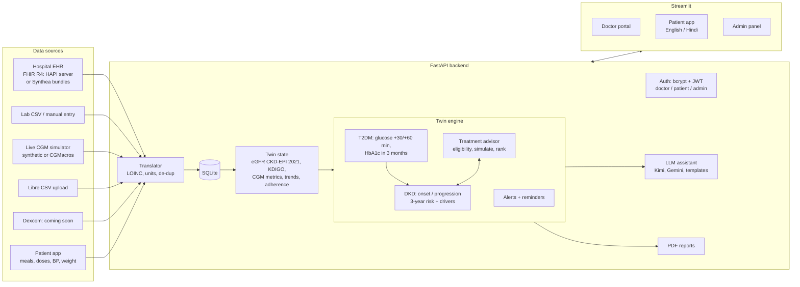

# GlycoRenal Twin: architecture

(Re-draw the picture with `scripts/make_architecture_diagram.py`; SVG version: `architecture.svg`.)

## In one sentence

Hospital records, lab results, a glucose sensor and the patient's own entries flow into one
database; the **twin state** turns them into clinical features; the **twin engine** predicts glucose
and kidney risk, ranks treatments and raises alerts; an **AI assistant** explains the results and
**PDF reports** summarise them for the doctor and the patient.

## Detailed flow

## Living-twin loop

Every new reading goes through `src/ingestion/translator.py`:

1. **Save**: map the code to LOINC, convert units (e.g. mmol/L -> mg/dL), skip duplicates, add a
   CKD-EPI 2021 eGFR row for every creatinine.
2. **Instant alerts**: glucose < 70 / < 54 / > 250, potassium > 5.5, BP > 160/100 (same alert not
   repeated within 60 minutes; thresholds in `config/alerts.yaml`).
3. **CGM** readings: 14-day metrics update and the glucose forecast re-runs (+30/+60 min); a
   "low glucose likely" alert fires from the forecast or the falling-trend safety net.
4. **Labs** (and medicine changes, and a daily 02:00 job): full re-run of DKD risk and HbA1c forecast.

## Code map

| Box | Code |
|---|---|
| Auth and roles | `src/auth/security.py`, `api/routers/auth.py`, `api/deps.py` |
| Translator, connectors | `src/ingestion/` (translator, fhir_import, simulator, libre_csv, dexcom stub, manual) |
| Database | `src/db/models.py`, `src/db/session.py`, demo data `src/db/seed.py` |
| Clinical maths | `src/clinical/` (egfr, kdigo, cgm_metrics, units, loinc, drugs, rules) |
| Twin state and engine | `src/twin/state.py`, `src/twin/engine.py` |
| Models | `src/models/` (dkd, t2dm, features, calibration); training `scripts/train_models.py` |
| Treatment advisor | `src/treatment/` (eligibility, simulate, rank) |
| Alerts, reminders, meals | `src/alerts/`, `src/reminders/`, `src/meals/` |
| LLM assistant | `src/llm/` (client, prompts, guardrails, rag, fallback, assistant) |
| PDF reports | `src/reports/` (common, pdf_doctor, pdf_patient) |
| API | `api/main.py`, `api/routers/` |
| Screens | `app/Home.py`, `app/pages/`, translations `app/i18n.py` |
| Clinical settings (no code) | `config/clinical_rules.yaml`, `config/alerts.yaml`, `data/reference/*.csv` |

## Models (summary; full details in [model_card.md](model_card.md))

| Model | Data | Result |
|---|---|---|
| dkd_current (has DKD now, no kidney labs as inputs) | **Real:** NHANES 2017-2020, 1,455 adults with diabetes | AUROC 0.72 (5-fold CV); Asian subgroup 0.68 |
| dkd_onset (3 years) | Synthetic Indian cohort, 2,000 x 5 years | AUROC 0.90, Brier 0.11 |
| dkd_progression (3 years) | Synthetic cohort; UCI CKD (Apollo, India) check | AUROC 0.87; UCI risk vs CKD 0.93; KDIGO rule agrees with diagnosis 94% |
| hba1c_forecast (3 months) | Synthetic cohort | MAE 0.26% when a drug is added (vs 0.39% "no change") |
| glucose_forecast (+30/+60 min) | Synthetic CGM (CGMacros when downloaded) | MAE 6 / 9 mg/dL (vs 13 / 21 "stays the same") |

## Limitations and next steps

- Long-term models learn from a simulated cohort: retrain and validate on real Indian longitudinal
  records (hospital EHR via FHIR), recalibrate to Indian incidence, fairness checks by sex and age.
- Dexcom live OAuth (sandbox) and WhatsApp/SMS reminders are stubs.
- Regulatory: decision-support software would need CDSCO Software-as-a-Medical-Device review.
- Privacy: production hosting must follow India's DPDP Act 2023 (consent, data in India, audit logs);
  PostgreSQL instead of SQLite; encrypted device tokens.
- Hindi: alert messages and medicine names are still English inside the Hindi view.
