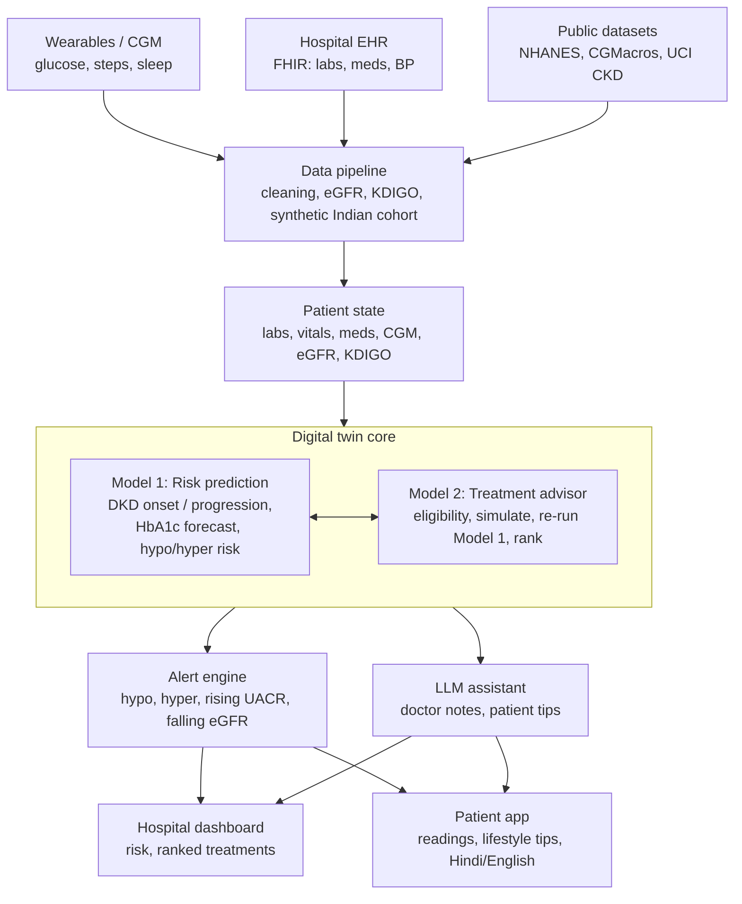

# GlycoRenal Twin: architecture

## Code map

| Box in the diagram | Code |
|---|---|
| Data pipeline | `src/pipeline/` (`egfr.py`, `kdigo.py`, `cgm.py`, `synthetic.py`, `nhanes_merge.py`) |
| Patient state | `src/patient_state/builder.py` |
| Model 1 | `src/model1_risk/model.py` |
| Model 2 | `src/model2_treatment/advisor.py` |
| Alert engine | `src/alerts/engine.py` |
| LLM assistant | `src/llm/assistant.py` |
| Living twin loop | `src/twin.py` |
| API | `api/main.py` (FastAPI) |
| Dashboards | `dashboards/hospital.py`, `dashboards/patient.py` (Streamlit) |
| Deployment | `Dockerfile`, `docker-compose.yml`, `.github/workflows/ci.yml` |

## Living twin loop

Every new lab report, CGM upload or prescription change is sent to `POST /patients`.
The twin rebuilds the patient state, re-runs Model 1, re-runs Model 2 (which itself calls
Model 1 for every simulated option), refreshes alerts and regenerates both explanations.
