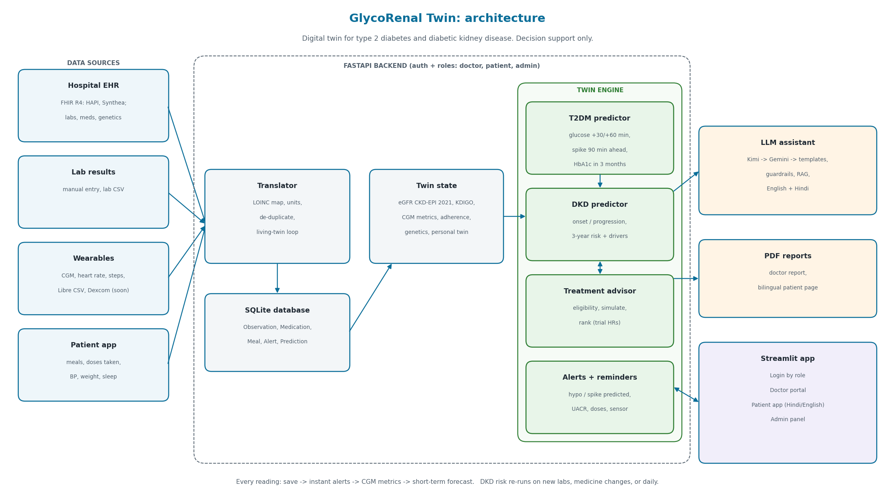
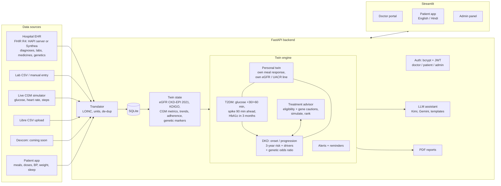

# GlycoRenal Twin: architecture

(Re-draw the picture with `scripts/make_architecture_diagram.py`; SVG version: `architecture.svg`.)

## In one sentence

Hospital records (labs, medicines, genetic results), wearables (CGM, heart rate, steps, sleep) and
the patient's own entries flow into one database; the **twin state** turns them into clinical
features; the **twin engine** predicts glucose, spikes and kidney risk, learns a **personal twin** of
this patient, ranks treatments and raises alerts; an **AI assistant** explains the results and
**PDF reports** summarise them for the doctor and the patient.

## 1. Layers

| Layer | What it does | Technology |
|---|---|---|
| Data sources | Hospital EHR, lab results, wearables, patient app | FHIR R4, CSV, simulator |
| Ingestion | Converts everything into one Observation format (LOINC code, value, unit, time, source) | `src/ingestion/` |
| Storage | One database for patients, readings, medicines, meals, alerts, predictions | SQLite via SQLModel (PostgreSQL-ready) |
| Twin state | Builds the patient's current clinical picture from the database | `src/twin/state.py` |
| Twin engine | Population models, personal twin, treatment advisor, alerts, reminders | XGBoost, scikit-learn, rules in YAML |
| Explain and report | AI assistant with guardrails, doctor and patient PDFs | Kimi / Gemini / templates, fpdf2 |
| API | Login, roles, every action as an HTTP endpoint, background jobs | FastAPI, JWT + bcrypt, APScheduler |
| Screens | Doctor portal, patient app (English/Hindi), admin panel | Streamlit + Plotly |
| Packaging | One Docker image (API, UI or both), CI runs tests and the demo dry run | Docker, GitHub Actions |

## 2. Detailed flow

## 3. Data sources and how they enter

| Source | Connector | What comes in |
|---|---|---|
| Hospital EHR (static) | `fhir_import.py`: Synthea bundles in `data/fhir_samples/`, file upload, or a live link to a FHIR R4 server (public HAPI by default): search, import, then automatic re-sync every `EHR_SYNC_MINUTES` (link stored as `DeviceConnection` provider `ehr_fhir`; optional `FHIR_AUTH_TOKEN`) | Patient, Condition (T2DM, CKD), lab Observations by LOINC, MedicationRequest -> medicines + reminders. Export back as a FHIR Bundle |
| Genetic test (static, simulated) | Stored as Observations with local codes `X-GEN-*` (`data/reference/loinc_map.csv`) | Kidney polygenic score, TCF7L2, CYP2C9, SLC22A1 |
| Lab results | `manual.py`, lab CSV upload | HbA1c, creatinine (-> eGFR), UACR, potassium, LDL |
| CGM + heart rate + steps (dynamic) | `simulator.py` replays a trace as if live: synthetic, a **real ShanghaiT2DM patient** ("▶ Real patient CGM"), or CGMacros once downloaded; `libre_csv.py`; `dexcom.py` stub | A reading every 5 minutes (every 3 s in demo mode) |
| Patient app | `manual.py`, meals and dose endpoints | Meals (Indian food list), doses taken/skipped, BP, weight, sleep |

Every connector returns the same `ObservationIn` and calls `translator.save()`.

## 4. Living-twin loop

Every new reading goes through `src/ingestion/translator.py`:

1. **Save**: map the code to LOINC, convert units (e.g. mmol/L -> mg/dL), skip duplicates, add a
   CKD-EPI 2021 eGFR row for every creatinine.
2. **Instant alerts**: glucose < 70 / < 54 / > 250, potassium > 5.5, BP > 160/100 (same alert not
   repeated within 60 minutes; thresholds in `config/alerts.yaml`).
3. **CGM readings** (`engine.run_short`, light):
   - glucose forecast +30/+60 min, and the "low glucose likely" alert (model plus a falling-trend
     safety net);
   - **spike early warning**: the probability of glucose above 250 within 90 minutes, from the last
     2 hours and the patient's habits at this time of day over the past 7 days. Raises
     "Glucose spike above 250 likely within 90 min".
4. **Labs, medicine changes, and a daily 02:00 job** (`engine.run_full`): DKD risk (with the genetic
   modifier), HbA1c forecast and all state-based alerts. The DKD model never runs on every CGM point.
5. **Nightly 02:30**: every personal twin is refitted on the patient's newest data.

Background jobs (APScheduler in `api/main.py`): live sensor ticks, missed doses (every 5 min), meal
spikes (every 1 min), stale sensors (every 10 min), hospital EHR re-sync (every 60 min), tomorrow's
dose events (00:05), daily twin (02:00), personal twins (02:30).

## 5. The twin engine

**Population models** (trained by `scripts/train_models.py`, saved in `models/`):

| Model | Predicts | Data | Result |
|---|---|---|---|
| `dkd_current` | Has DKD now, from non-kidney data | **Real:** NHANES 2017-2020, 1,455 adults with diabetes | AUROC 0.72 (5-fold CV) |
| `dkd_onset` | DKD within 3 years | Synthetic Indian cohort, 2,000 x 5 years | AUROC 0.90 |
| `dkd_progression` | KDIGO stage worse or eGFR -30% in 3 years | Synthetic cohort; UCI CKD (India) check | AUROC 0.87; KDIGO agrees with diagnosis 94% |
| `hba1c_forecast` | HbA1c in 3 months | Synthetic cohort | MAE 0.26% when a drug is added |
| `glucose_forecast` | Glucose +30 / +60 min | Synthetic + **real** CGM (ShanghaiT2DM, 100 people) | Real held-out patients: MAE 9.8 / 17.1 mg/dL (vs 11.8 / 19.4 "stays the same") |
| `glucose_spike_90m` | Glucose above 250 within 90 min | Synthetic + **real** CGM | Real held-out patients: AUROC 0.93; 72% of spikes warned at least 30 min ahead |

**Genetic markers (simulated):** a kidney polygenic score at or above the 80th percentile multiplies
the odds of the DKD outcome by 1.35 (below the 20th: 0.85). TCF7L2 and CYP2C9 add sulfonylurea
cautions; SLC22A1 adds a metformin caution. All values are in `config/clinical_rules.yaml -> genetics`.

**Personal twin** (`src/twin/personal*.py`): learns *this* patient, starting from population values
and becoming more personal with every day of data:
- glucose: their own rise per 10 g carbs, peak time and walking effect (gamma meal curve, ridge
  shrinkage to population priors), checked by replaying the last 3 days;
- kidneys: their own eGFR and UACR lines (Bayesian, population slope as prior) and projected years
  to eGFR 45 / 30, with and without treatment;
- a maturity score ("how well the twin knows the patient").

**Treatment advisor** (`src/treatment/`): eligible options (KDIGO 2022 / ADA rules plus gene cautions)
-> simulate each on the twin (HbA1c/BP/weight change -> re-run DKD model -> trial hazard ratio) ->
rank by absolute risk reduction. Doctors see all options; patients see lifestyle levers only.

## 6. AI assistant and reports

- `src/llm/`: Kimi (primary) -> Gemini (backup) -> template text. It receives a de-identified JSON
  of the twin (no names), plus the top 3 guideline snippets (TF-IDF RAG over `data/guidelines/`).
  It explains and never predicts.
- Guardrails: patients are never told to change a medicine ("please discuss this with your
  doctor", English and Hindi); a low-sugar alert gives a fixed 15-15 safety message; there is
  always a "decision support only" footer; answers are cached for 30 minutes.
- `src/reports/`: the doctor PDF (labs with stale flags, KDIGO grid, trends, CGM profile, risk,
  genetics, ranked options, AI summary) and a one-page bilingual patient PDF.

## 7. Security and roles

- Users log in with a username and password (bcrypt) and get a JWT. The role decides the screens
  and data: an admin manages users and data, a doctor sees their assigned patients, a patient sees
  only themselves (`api/deps.patient_for`).
- Keys live only in `.env` (never committed; `scripts/check_secrets.py` runs before commits and
  in CI).
- Only de-identified IDs go to the LLM.

## 8. Code map

| Box | Code |
|---|---|
| Auth and roles | `src/auth/security.py`, `api/routers/auth.py`, `api/deps.py` |
| Translator, connectors | `src/ingestion/` (translator, fhir_import, simulator, libre_csv, dexcom stub, manual) |
| Database | `src/db/models.py`, `src/db/session.py`, demo data `src/db/seed.py` |
| Clinical maths | `src/clinical/` (egfr, kdigo, cgm_metrics, units, loinc, drugs, genetics, rules) |
| Twin state and engine | `src/twin/state.py`, `src/twin/engine.py` |
| Personal twin | `src/twin/personal.py`, `personal_glucose.py`, `personal_kidney.py`; API `api/routers/personal.py` |
| Models | `src/models/` (dkd, t2dm, features, calibration, registry); training `scripts/train_models.py` |
| Synthetic data | `src/pipeline/` (cohort, cgm_synth, cgmacros); `scripts/build_synthetic_cohort.py` |
| Treatment advisor | `src/treatment/` (eligibility, simulate, rank) |
| Alerts, reminders, meals | `src/alerts/`, `src/reminders/`, `src/meals/` |
| LLM assistant | `src/llm/` (client, prompts, guardrails, rag, fallback, assistant) |
| PDF reports | `src/reports/` (common, pdf_doctor, pdf_patient) |
| API | `api/main.py`, `api/routers/` (auth, patients, twin, personal, treatments, devices, ehr, meals, reminders, alerts, llm, reports, admin) |
| Screens | `app/Home.py`, `app/pages/` (doctor_portal, patient_app, admin_panel), translations `app/i18n.py` |
| Clinical settings (no code) | `config/clinical_rules.yaml`, `config/alerts.yaml`, `data/reference/*.csv` |
| Tests and checks | `tests/` (101 tests), `scripts/dry_run_demo.py`, `.github/workflows/ci.yml` |
| Deploy | `Dockerfile`, `docker-compose.yml`, `deploy/start.sh` (`MODE=api / ui / all`) |

## 9. Limitations and next steps

- Long-term models, the spike model and genetic effects are built on simulated data: retrain and
  validate on real Indian longitudinal records (hospital EHR via FHIR) and real CGM (CGMacros,
  AI-READI), recalibrate to Indian incidence, and run fairness checks by sex and age.
- Heart-rate variability and sleep stages are not modelled yet (sleep duration and heart rate are).
- Dexcom live OAuth (sandbox) and WhatsApp/SMS reminders are stubs.
- Regulatory: decision-support software would need CDSCO Software-as-a-Medical-Device review.
- Privacy: production hosting must follow India's DPDP Act 2023 (consent, data in India, audit
  logs); PostgreSQL instead of SQLite; encrypted device tokens.
- Hindi: alert messages and medicine names are still in English inside the Hindi view.
